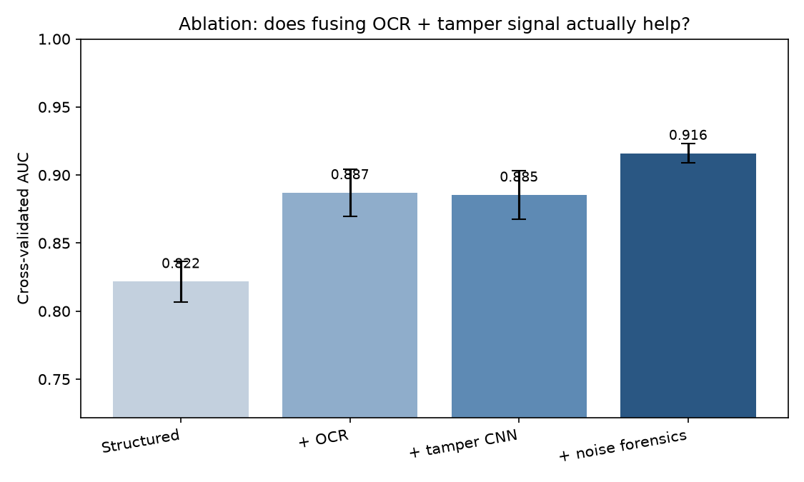

# Ablation Study — Does Multimodal Fusion Help?

5-fold cross-validated AUC, 3000 claims, fraud rate 19.4%.

| Feature set | AUC | Std dev | # numeric features |
|---|---|---|---|
| A. Structured only | 0.8217 | 0.0151 | 9 |
| B. Structured + OCR | 0.8869 | 0.0171 | 12 |
| C. Structured + OCR + tamper CNN | 0.8852 | 0.0178 | 13 |
| D. Structured + OCR + tamper CNN + noise forensics (full model) | 0.9159 | 0.0071 | 15 |

**Adding OCR features: +0.0653 AUC — a real, meaningful improvement.**

**Adding the tamper CNN score: -0.0018 AUC — essentially no difference — within noise.**

**Adding noise-forensics features: +0.0307 AUC — a real, meaningful improvement.**

Each step is cumulative, so its gain is what it adds on top of everything before it. Gains smaller than the fold-to-fold std dev should not be reported as real.

**Total gain from structured-only to the full model: +0.0942 AUC.**

## What this means

The multimodal fusion claim holds up on this synthetic dataset: combining OCR and tamper-detection signal with structured claim data measurably outperforms structured data alone.

## Caveat

This test is on synthetic data from generate_synthetic_claims.py. Both the synthetic forgeries and the noise-forensics features that detect them were designed in this project. The noise-inconsistency cue is a documented real-world forensic signal, and half the forgeries deliberately hide it ('careful' style), but real forgeries vary far more than this generator, so these gains may not transfer to real bills.

